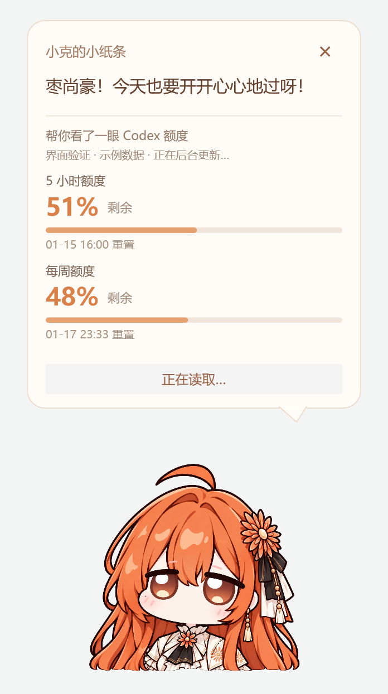

# 小克陪伴 · Xiaoke Codex Buddy

一个陪你等待 Codex 的 Windows 桌面人偶：点一下，小克弹一弹，顺便帮你看一眼剩余额度。

当前版本 **v1.2**，桌面程序名为「Q版 Claude娘 Codex 额度查询-v1.2」。这是独立悬浮工具，通过本机 Codex 读取账户额度。

## 功能

- 点击人偶，弹出「小克的小纸条」：一句关心的话，以及额度剩余百分比和重置时间。
- 人偶与气泡均有回弹动画，拖动可调整位置。
- 先显示内存缓存，再后台更新，避免每次点击都出现空白等待。
- 在 Codex/ChatGPT 桌面宿主前台累计使用 5 分钟，弹出一次关心提醒；离开时暂停，不补弹积压提醒。
- 额度框连续 6 秒无点击自动缩小淡出；点击框内或人偶重新计时，点击外部立即收起。
- 最小化或切换到其他应用时隐藏；可选择随 Windows 登录启动，在后台等待宿主出现。

## 运行要求

Windows 10/11，.NET Framework 4.8，以及已经安装并登录 ChatGPT 账户的本机 Codex CLI。

程序会从 PATH 或当前用户的 `AppData/Local/OpenAI/Codex/bin` 目录寻找 `codex.exe`。桌面应用已登录不一定代表 CLI 可查询额度；出现认证提示时，运行 `codex login` 后重试。

## 从源码构建

在项目根目录用 PowerShell 执行：

```powershell
.\scripts\Build.ps1
.\scripts\Test.ps1
```

构建仅使用 Windows 自带的 .NET Framework C# 编译器，无需安装 Python、Node.js 或下载 NuGet 包。输出位于：

```text
dist/Q版 Claude娘 Codex 额度查询-v1.2/
```

双击该目录中的同名 `.exe` 启动，右键人偶可退出。请保留目录内的图片及配置文件。

## 自动启动

构建完成后，在 PowerShell 中执行：

```powershell
& '.\dist\Q版 Claude娘 Codex 额度查询-v1.2\Enable-Autostart.ps1'
```

取消自动启动：

```powershell
& '.\dist\Q版 Claude娘 Codex 额度查询-v1.2\Disable-Autostart.ps1'
```

脚本只在当前用户的 Windows 启动目录添加或移除快捷方式，不修改 Codex 的启动文件。移动程序目录后需要重新注册。

## 数据来源与已知限制

额度通过本机 `codex app-server` 的 `account/rateLimits/read` 读取，不直接读取登录令牌、不发起模型推理、不消耗重置券。接口见 [Codex App Server 文档](https://learn.chatgpt.com/docs/app-server)。

宿主在前台时，每分钟更新一次；15 秒内重复点击复用缓存，刷新按钮可强制查询。缓存只保存在进程内存，显示的是注明更新时间的上次结果。首次启动仍需要等待一次真实查询。

显示条件依据 Windows 前台宿主窗口，无法区分同一 ChatGPT 窗口内部的不同页面。额度可用性和返回字段取决于本机 Codex、账户及网络。

## 项目结构

```text
src/       WPF 程序、应用清单和运行配置
assets/    透明人偶素材
scripts/   构建、自检、启动与自动启动脚本
docs/      布局预览（额度为示例数据）
```

素材由用户提供的角色图片经透明底处理得到。预览图用于展示布局，具体文字、间距和动画以当前程序为准。


